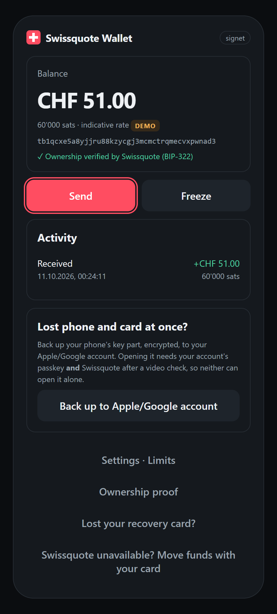
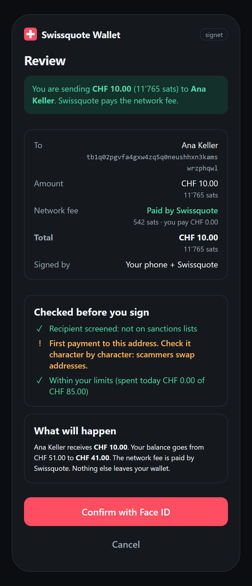
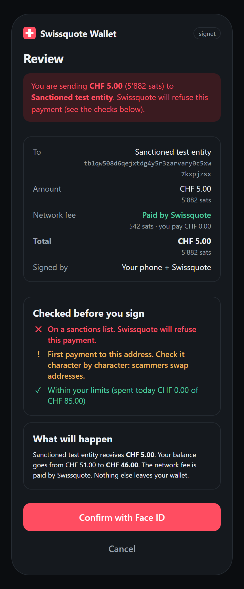
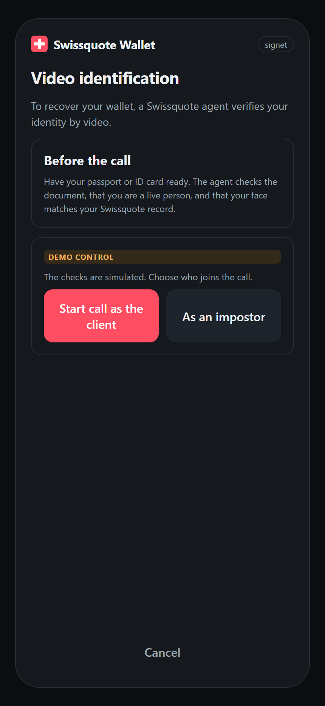
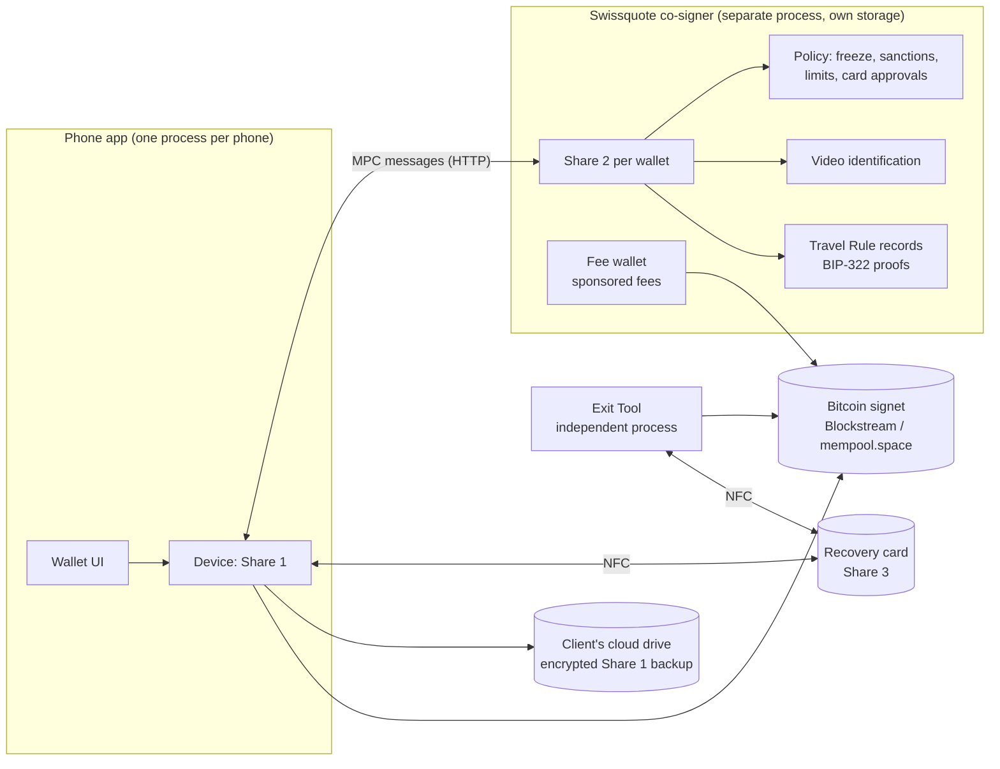

# Swissquote Self-Custody Wallet

*Team **Two of Three**: Sergi Boned and Arnau Ferrer · EPFL Hackathon 2026, Swissquote Wallet Challenge.*

**Your keys, your crypto, with a Swiss safety net.** A self-custody wallet that Swissquote could offer to its clients: the client controls the funds, Swissquote can never move them on its own, and the wallet stays one tap away from the Swissquote account.

The wallet's key is split with **MPC (2-of-3 threshold ECDSA)** between the client's **phone**, a **Swissquote co-signer** and a **recovery card**. Any two sign; the full key never exists anywhere. No seed words, and Swissquote pays the network fees.

> Hackathon prototype on **Bitcoin signet** (a Bitcoin test network). Everything that is simulated is listed in [Real vs mocked](#2-architecture) and labelled **DEMO** in the app.
> The complete design, including parts not built yet, is in [WORKFLOW.md](WORKFLOW.md). A detailed walkthrough with answers to likely questions from the bank is in [GUIDE.md](GUIDE.md). New here? Start with [START-HERE.md](START-HERE.md).

## Evidence: real transactions on Bitcoin signet

| What | Transaction | Signed by |
|---|---|---|
| Payment, phone and co-signer as separate processes | [`bedda5ed…5908`](https://blockstream.info/signet/tx/bedda5edf4ad2d5f4e6d1f7e329b737dfa8d2a50fd7081121a0136fc02be5908) | Phone + Swissquote |
| **Gasless payment:** Swissquote's fee wallet pays the whole fee; the client sends exactly 3,000 sats and pays 0 | [`f70e0a95…959d`](https://blockstream.info/signet/tx/f70e0a9570a02b97ffb63d836d268e7cc092cb0c31841c9d2a11bf7a00d0959d) | Phone + Swissquote (MPC) · Swissquote fee wallet |
| Gasless payment to the client's own Swissquote account, fee-wallet change split into two coins | [`6451b8a7…897b`](https://blockstream.info/signet/tx/6451b8a72ff7ecd1a8597bb6d05bdfef22db481015cb39d0e07f59ee331a897b) | Phone + Swissquote · fee wallet |
| Recovery sweep into a new wallet after a lost phone | [`a63be18a…6155`](https://blockstream.info/signet/tx/a63be18a9b45eea52c0af37ef79924d58da6e39321e6be7d393a9146baa46155) (earlier run: [`70b8dad2…fab7`](https://blockstream.info/signet/tx/70b8dad22d7082fa643e86798ae260b8a77ef7cf9cbc7427d4f77c378958fab7)) | Recovery card + Swissquote |
| Recovery after losing phone **and** card, from the Apple/Google passkey + Swissquote backup | [`9b970345…d6a9`](https://blockstream.info/signet/tx/9b9703453997f8bac31ce9ac40bac4c67f5cf93fea35ec1caa6322fb80d8d6a9) | Restored phone share + Swissquote |
| **Exit Tool** (independent tool, browser UI): all funds moved with no Swissquote server involved | [`4419a6e8…dde7`](https://blockstream.info/signet/tx/4419a6e8747bed34cac75e368ae8a5aff6833062f260f80a32603a1900e2dde7) | Phone + card only |
| Escape from the command line (co-signer unreachable, wallet frozen) | [`fca03aec…9478`](https://blockstream.info/signet/tx/fca03aeccae064d8ce2cdf5c7ab6cb76a94a5d3540ab8803ebf349ed39009478) | Phone + card only |

Ownership proofs (BIP-322) are signatures, not transactions: they appear in the app (*Ownership proof*) and in the co-signer log as `TRAVEL RULE record`.

## Screenshots

| Home | Review: fee paid by Swissquote | Sanctioned recipient | Recovery: video ID |
|---|---|---|---|
|  |  |  |  |

More in [`docs/screenshots/`](docs/screenshots/) (ownership proof, recovery card tap, Exit Tool).

## Run the demo

Requires Node.js 20+ (tested with Node 20 and 24).

```bash
npm install
npm run demo          # co-signer :4000, phones A :5001, B :5002, C :5003, Exit Tool :5100 (recovery wait 20 s / 40 s)
npm run demo:reset    # in a second terminal: returns leftover funds, new funded wallet on phone A, empty phones B and C
npm test              # 19 automated tests: MPC, BIP-322 vectors, policy, backup
npm run demo:wipe -- b   # factory-reset one phone (a, b or c); refuses if it holds funds unless --force
```

Open **http://localhost:5001** (the client's phone) and **http://localhost:5002** (the same client's new phone after a loss: use *Recover my wallet* there, since the card already belongs to phone A's wallet). **http://localhost:5003** is a different client with a blank card: use it to show *Create my wallet* from scratch. The commands work from the project root or from `core/`.

**Demo story (~2 min):** phone A shows the balance and "✓ Ownership verified by Swissquote (BIP-322)" → **Send** CHF 10 to *Ana Keller*: the review shows *Network fee: Paid by Swissquote*, the pre-signing checks (sanctions, recipient, limits) and what will happen → Face ID → sent, signed by phone + Swissquote → try the *Sanctioned test entity* contact: flagged on the review screen, then refused by the co-signer → on phone B, *Recover my wallet* → choose **Impostor** (refused) → choose **Real client** → countdown → wallet restored, funds swept → phone A shows the wallet as replaced → open the **Exit Tool** (:5100) to show the funds can always leave without Swissquote.

The demo's funds come from a "treasury" wallet in `core/client/demo/treasury` (not in git). On a fresh copy, the first `npm run demo:reset` creates the treasury and prints its address: request signet coins for it from a faucet (e.g. signet257.bublina.eu.org), wait for 1 confirmation, then run `npm run demo:reset` again. Each reset first sends what the demo phones still hold back to the treasury and keeps Swissquote's fee wallet topped up. Only spend **confirmed** faucet coins (faucets replace unconfirmed transactions).

More flows in the app: **Back up to Apple/Google account** then, on phone B, **I lost my card too · Restore from my Apple/Google account**; **Lost your recovery card?** (new card, same address); **Ownership proof**; **Settings · Limits**; **Swissquote unavailable? Move funds with your card** (escape, works with the co-signer stopped); the *My Swissquote account* contact (a verified, same-owner destination).

Command-line client: `node core/client/wallet.mjs` (`create`, `balance`, `send`, `freeze`, `prove`, `backup`, `replace-card`, `escape`, `recover`).

Block explorers: Blockstream first, **mempool.space as automatic fallback** (same Esplora API) when Blockstream rate-limits (~700 requests/hour per IP) or is unreachable. Reads are cached (15 s, fees 2 min). `ESPLORA_URLS` overrides the list.

If `npm run demo` reports a port in use, an earlier demo is still running: stop the old `node` processes on ports 4000, 5001, 5002, 5003 and 5100.

---

## 1. Custody model and threat model

**Decision: 2-of-3 MPC threshold signatures (DKLs23, ECDSA on secp256k1).**

| Share | Holder | Lives in |
|---|---|---|
| Share 1 | Client | Phone, behind Face ID |
| Share 2 | Swissquote | Isolated co-signer with its own storage |
| Share 3 | Client | Released only by a FIDO2 recovery card + PIN *(card simulated in the prototype)* |

**Why MPC.** One key works on Bitcoin and EVM chains (same curve), unlike ERC-4337 accounts, which are EVM-only. Clients get no seed phrase to lose. The key is never reassembled, unlike a split seed (Shamir/SLIP-39), which must be put back together to sign.

| Model | Why not (for this client base) |
|---|---|
| Custodial account | Swissquote moves the funds: bank custody rules, capital, segregation; the client gains nothing over today's account |
| Seed phrase | A typical Swissquote client will lose or photograph 24 words; one leak is total loss |
| ERC-4337 smart account | EVM-only (no Bitcoin), gas and on-chain recovery per chain |
| Shamir / SLIP-39 split seed | The seed is reassembled in one place to sign; Swissquote + a partner could restore it without the client |
| **MPC 2-of-3 (chosen)** | No single point of failure; Swissquote can block but not move; multi-chain; no seed words. Cons: library licence (non-commercial); no on-chain timelocks with a single key; the phone OS vendor must be trusted, as for any mobile wallet |

**Threat model**

| Question | Answer |
|---|---|
| Can Swissquote alone move the funds? | **No.** It holds 1 of 3 shares. Tested: a single share cannot complete a signature. Its fee wallet only ever adds Swissquote's own coins. |
| Swissquote together with a partner? | No partner holds a share. The card's key is born in its chip. The optional cloud backup could be opened only by Apple/Google **and** Swissquote acting together (e.g. under a court order); this is disclosed, and clients who do not want it can skip the backup (see [WORKFLOW §10](WORKFLOW.md)). |
| Who could steal funds? | A thief needs two of: unlocked phone, card + PIN, Swissquote's co-signature. Swissquote co-signs only after sanctions checks and limits, and only with the phone in daily use. |
| Who could lock the client out? | Losing phone **and** card without a backup, or losing them at a time when Swissquote no longer exists. Swissquote freezing the wallet does **not** lock the client out: phone + card can always move the funds. |

## 2. Architecture



| Component | Status |
|---|---|
| MPC key generation and signing (DKLs23) | **Real** |
| Distributed key generation over HTTP: Share 2 is born on the co-signer and never leaves it | **Real** |
| Co-signer as a separate process with its own storage; client never holds Share 2 | **Real** (`core/cosigner/server.mjs`) |
| Co-signer rebuilds the sighash from the transaction itself before signing | **Real** |
| Bitcoin transactions (P2WPKH, BIP-143, low-S), broadcast to signet | **Real** |
| Freeze, daily limit, sanctions refusal, recovery waiting period, card-only recovery sweep, lost-card re-sharing | **Real** logic |
| Card threshold, daily limit, card-tap challenges (P-256 signatures verified by the co-signer), limit settings | **Real** logic |
| **Fee sponsoring** (Swissquote's fee wallet adds an input that pays the fee; quotas, caps, co-signed-only) | **Real**, on signet (`core/cosigner/sponsor.mjs`) |
| **Pre-signing screening** shown in plain language (sanctions, verified counterparty, first payment, limits, effect on balance) | **Real** logic; directory and sanctions list are mocks |
| Ownership proof for the Travel Rule (BIP-322 simple, MPC-signed, verified by the co-signer; checked against the BIP-322 test vectors) | **Real** |
| Double-locked Share 1 backup (HKDF, AES-256-GCM, HMAC verifier) | **Real** |
| Exit Tool: signs with phone + card shares, never contacts the co-signer | **Real** (`core/client/escape.mjs`) |
| Explorer fallback (Blockstream → mempool.space) | **Real** |
| Sanctions list, compliance provider, verified-counterparty directory | **Mock** (local JSON files) |
| Video identification | **Mock** (demo control: real client / impostor) |
| Face ID | **Mock** (camera preview, no recognition) |
| Client authentication to the co-signer | **Mock** (bearer token instead of passkeys) |
| Recovery card authenticator (key in chip, PIN, 8 tries) | **Mock** (a folder holding Share 3; a FIDO2 card in production) |
| Apple/Google passkey (PRF) and account keychain; client's cloud drive | **Mock** (folders) |
| Client number in the ownership record | **Mock** (random `SQ-…` id) |
| CHF amounts, contacts | **Mock** (indicative rate) |

## 3. Wallet creation

1. The client (already KYC-verified at Swissquote) taps **Create my wallet** and confirms with Face ID.
2. The phone and the co-signer run **distributed key generation** in four message rounds. The phone runs the phone and card parties; Swissquote runs its own party on its server. Nobody sees the full key.
3. Share 1 is stored on the phone, Share 3 is sealed to the recovery card, Share 2 stays on the co-signer. The card's public key (P-256) is registered with Swissquote at the same moment.
4. **Identity link (implemented):** right after creation the wallet signs an **ownership message with BIP-322** (client number, address, date, one-time code). Swissquote writes the message and computes what is signed itself, so this can never be turned into a payment; it verifies the signature and records *address X belongs to client Y*. No funds move, no fee. Because Swissquote cannot sign alone, a valid signature proves the client took part. Recovered wallets sign a new proof automatically. In the app: *Ownership proof*; CLI: `wallet.mjs prove`.

## 4. Authentication

- **Daily use:** Face ID unlocks the phone share; the co-signer authenticates the session *(prototype: token; design: passkey/WebAuthn)*.
- **Before co-signing**, the co-signer checks: wallet not frozen, recipient not sanctioned, the day's limits, and that the counterpart is the **phone** share.
- **Small vs. high value (implemented):** up to the **card threshold** (default 25,000 sats ≈ CHF 21 per day) Face ID is enough. Above it, the **recovery card + PIN** must approve that exact payment: Swissquote issues a single-use challenge bound to the transaction ID, the card signs it after checking its PIN, and Swissquote verifies the signature with the card key registered when the wallet was created. Above the **daily limit** (default 100,000 sats ≈ CHF 85) payments are refused. *Design only:* a 24-hour cooling-off for new addresses.
- **Settings · Limits (implemented):** the client can change both limits. Lowering takes effect at once; raising needs a card tap bound to the new values, up to a maximum (1,000,000 sats in the demo).
- The card key is registered only at wallet creation, recovery or a verified card replacement, so a thief with an unlocked phone cannot enrol a card of their own. The demo card PIN is `123456`.
- **Plain-language review before every signature (implemented):** amount in CHF and sats, recipient name, who pays the fee, who signs, *Checked before you sign* (sanctions screening, verified counterparty or first payment to a new address, limits and whether the card is needed) and *What will happen* (who receives what, balance before and after).

## 5. Recovery

**Lost or stolen phone** (implemented, demo on phone B):
1. The client taps the recovery card on a new phone.
2. **Video identification** with Swissquote. On success the old wallet is frozen at once and alerts go to every channel.
3. **Waiting period** (48 h in production, 20 s in the demo) so the real client can cancel a fraudulent recovery.
4. A **brand-new wallet** is created (new shares, new card share) and proves its ownership (BIP-322). Refreshing the old shares would not be enough: a thief keeps the old phone share forever.
5. Old card + Swissquote **sweep** all funds into the new wallet. In recovery mode the co-signer only accepts the **card** as counterpart and only signs a transaction whose outputs all go to the new wallet.
6. The old phone is left frozen and retired.

**Refusing an attacker who has the phone and the email** (bonus):
- Fails video identification → refused, client alerted. *(Shown in the app.)*
- Even if the attacker fools the video check (deepfake) and waits out the delay, the sweep is refused: the phone share is not accepted in recovery. *(Tested from the command line; see WORKFLOW build table.)*
- Email is never a key: stealing it opens nothing.

**Lost recovery card** (implemented, "Lost your recovery card?" in the app): after video identification and the waiting period, the phone and Swissquote **re-share the same key** onto a new card (DKLs key recovery). The address and balance stay the same; the lost card's share no longer combines with the new shares (automated test); the old phone and co-signer shares are overwritten. The verification step matters: without it, a thief with an unlocked phone could enrol their own card and gain two shares.

**Lost phone and card at once** (implemented, optional "Back up to Apple/Google account"): the phone's share is encrypted with two locks and stored in the client's own cloud drive. **Lock A** is the client's **Apple/Google passkey** (WebAuthn PRF output); **lock B** is a random key held by Swissquote. To recover on a new phone: sign in to the Apple/Google account (the passkey syncs back) → video identification → a **longer waiting period** (7 days in production, 40 s in the demo) → the passkey proves itself to Swissquote **without revealing anything** (Swissquote holds only an HMAC verifier) → Swissquote releases lock B → the backup opens → phone share + Swissquote sweep the funds into a new wallet. Proof attempts are limited (5 per recovery, 10 per wallet).
*Trade-offs, stated openly:* neither Apple/Google nor Swissquote can open the backup alone, but the two together could (for example under a court order), which is already true of any wallet running on their phones. A thief holding the **unlocked** phone may also hold the synced passkey: that is why this route waits longer and alerts every channel. There is **nothing to write down**: no seed words, no phrase. Clients who do not want this trade-off simply skip the backup; the card route still works. *(Simulated in the demo: the passkey and the account keychain, and the cloud drive, are folders.)*

**Independent Exit Tool** (implemented, http://localhost:5100, `core/client/escape.mjs`): a separate, non-Swissquote-branded open-source tool for when Swissquote is gone. It imports the phone's exported key share *(simulated: pick a demo phone)*, unlocks the recovery card with its PIN, previews a sweep to any address, signs **on the computer with phone share + card share** and broadcasts through a public explorer. It never contacts the co-signer: its co-signer address is deliberately unreachable. Tested end to end with real funds.

**If Swissquote disappears:** the funds are on-chain, not at Swissquote. The phone and the card sign together locally with no server.

## 6. Business case

Clients who want self-custody withdraw their crypto today and often leave. This wallet keeps them one tap from their account (*My Swissquote account* is a verified, same-owner destination), so buying, selling and converting to CHF stay at Swissquote.

| Lever | How |
|---|---|
| Retention | Self-custody without leaving: deposits back to the trading account are one tap, Travel-Rule-clean |
| Premium tier | Higher limits, metal card, second card, extended backup |
| Fees | Small fees on approved DeFi/swap routes; network fees bundled into the subscription |
| Lower costs | Swissquote cannot move the funds: no custody capital, insurance or cold storage for these assets; Travel Rule ownership checks are automatic instead of manual |
| New clients | Self-custody users who want Swiss-grade security and a human recovery path |

Fee sponsoring costs Swissquote about 250–550 sats per payment at today's signet rates (1–2 sat/vB). A sponsored payment is about 240 vB, so on mainnet it costs under CHF 1 at normal fee levels (a few sat/vB) and more during congestion; it is capped per payment and per day. *Illustrative, hypothetical figures:* 10,000 users with 20% premium at CHF 9/month ≈ CHF 216,000/year; retaining CHF 50M of crypto at 1% annual trading revenue ≈ CHF 500,000/year; sponsoring 2 payments a month for 10,000 users at about CHF 0.80 ≈ CHF 190,000/year, covered by the premium tier and trading revenue.

## Custody and the Travel Rule (Switzerland, simplified, not legal advice)

- **Custody** depends on who can move the funds. Swissquote holds 1 of 3 shares and cannot act alone, and no partner holds a share, so the wallet is closer to **software** than to bank custody. Blocking (refusing to co-sign) is not moving. The fee wallet only adds Swissquote's own coins to a payment the client has already signed.
- **Travel Rule / FINMA:** a Swiss bank may only send to or receive from a self-hosted wallet after verifying who owns it. Here ownership is established when the wallet is created inside the client's Swissquote session and confirmed with a **BIP-322 ownership signature** recorded by Swissquote, so transfers between the account and the client's own wallet can be verified automatically. After a recovery, the new wallet proves ownership again.
- **Payments to third parties:** the client initiates and controls them from a self-hosted wallet; Swissquote co-signs and screens. Whether Swissquote is the "sending institution" here is the grey zone named in the challenge; we argue it is not (it cannot initiate or move funds), and flag it openly. See [GUIDE.md](GUIDE.md) for the full argument.

## Bonus topics

| Topic | Status |
|---|---|
| **Gasless transactions** | **Implemented on Bitcoin (signet):** Swissquote's fee wallet adds one input to the client's payment and pays the whole network fee; the client sends exactly the amount and needs no extra coins. *Who pays:* Swissquote, from its own fee wallet (funded by the premium tier / trading revenue). *Abuse prevention:* only wallets with a verified BIP-322 ownership proof; Swissquote signs its input last and only for a payment it already co-signed under the normal policy; at most 1,000 sats per payment, 10 payments and 5,000 sats per wallet per day; fee rate capped; each fee coin reserved for one wallet at a time and never signed twice; if the quota is used up the client simply pays the fee. Evidence: [`f70e0a95…`](https://blockstream.info/signet/tx/f70e0a9570a02b97ffb63d836d268e7cc092cb0c31841c9d2a11bf7a00d0959d). *EVM design:* the same MPC key owns an ERC-4337 account with a Swissquote paymaster for USDC (or EIP-3009 `transferWithAuthorization` relayed by Swissquote). |
| **Compliant dApp interaction** | **Implemented for payments:** sanctions screening before signing (shown) and when co-signing (enforced); verified counterparties (*Your Swissquote account*); first payment to a new address flagged; card approval above a threshold; daily limits; plain-language effects on the balance before Face ID. *Design only:* approved-dApp list and contract-call simulation for EVM DeFi (the co-signer would decode calldata and only co-sign approved contracts and methods). |
| Recovery that refuses an attacker with phone + email | **Implemented**: refused at video ID, and refused at the sweep even if video ID is fooled |

## Tests

`npm test` runs 19 automated tests (Node's built-in test runner, no extra dependencies): 2-of-3 DKG and signing for every pair, a single share cannot sign, lost-card re-share keeps the address and rejects the old card share; BIP-322 against the official test vectors; co-signer policy (freeze, sanctions, card threshold, daily limit, sponsored change not counted); double-locked backup (both locks needed, tampering detected, verifier). End-to-end flows are proven by the signet transactions above.

## Known limitations

- The recovery card, Face ID, video identification, passkeys, sanctions provider and counterparty directory are simulated (see table above).
- The card cannot run MPC itself, so whenever Share 3 is created or used (wallet creation, recovery, escape) the phone briefly holds two shares in memory. Production mitigation: seal Share 3 to the card immediately and wipe it from memory; keep these windows short and rare.
- The fee wallet is a single-key hot wallet inside the co-signer process for the demo; in production it belongs in a separate service with an HSM, holding only a few days of fees.
- Swissquote publishes the app; production needs open source, reproducible builds and audits.
- Cancelling a recovery uses the old phone's token in the prototype; in production it must come from the Swissquote web login or a phone call.
- A serialized MPC share is ~247 KB, which rules out storing backups on-chain.
- The MPC library is licensed for non-commercial use only (see [NOTICE.md](NOTICE.md)).
- Production design for Bitcoin (Taproot tree with on-chain timelocks) is described in [WORKFLOW §15](WORKFLOW.md), not built.

## AI tools used

| Tool | Used for |
|---|---|
| **Claude** (Claude Code in the Claude desktop app; Claude Sonnet and Claude Opus models) | Explaining the challenge; designing and critiquing the custody model, threat model and recovery flows; researching FIDO2 hardware and signet faucets; writing the MPC, co-signer, client, fee-sponsoring, BIP-322 and app code and the tests; running and debugging the signet transactions; writing WORKFLOW.md, GUIDE.md, this README and the pitch deck |
| *Team to complete* | *Any other AI tools used and what for* |

## Repository layout

```
START-HERE.md          install, first run, demo script, troubleshooting
GUIDE.md               detailed walkthrough of everything built + answers to likely questions
WORKFLOW.md            full design and lifecycle, threat model, build status
NOTICE.md              third-party licence notice (Silence Laboratories)
pitch/                 pitch deck (offline HTML + slide sources) and speaker notes
docs/screenshots/      screenshots of the app and the Exit Tool
submission/            DoraHacks form texts (SUBMISSION.md, description.md) and logo (logo.svg, logo-480.png)
core/
  shared/              mpc.mjs (DKLs wire protocol), bitcoin.mjs (Esplora + fallback + cache),
                       backup.mjs (double-locked backup), bip322.mjs (ownership proofs)
  cosigner/            server.mjs (Swissquote co-signer), policy.mjs (limits, sanctions),
                       sponsor.mjs (fee wallet), sanctions.json + directory.json (MOCK data)
  client/              device.mjs (wallet logic), card.mjs + keychain.mjs (MOCK card and passkey),
                       wallet.mjs (CLI), app.mjs + public/index.html (phone app),
                       escape.mjs + public/escape.html (Exit Tool)
  scripts/             demo launcher, reset and wipe
  test/                automated tests (npm test)
spike/                 first experiments (MPC spike, lost-card spike)
```
