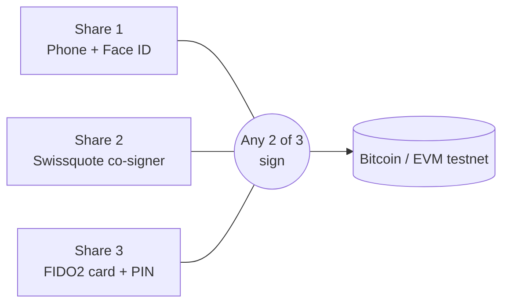
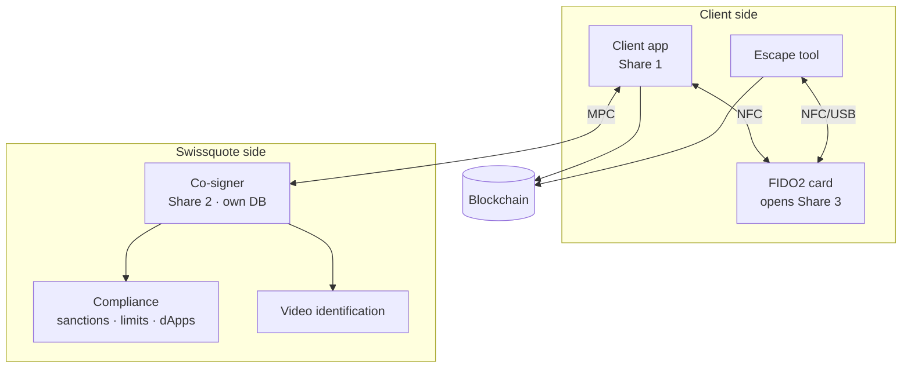

# Swissquote Self-Custody Wallet — Complete Workflow

> Team reference document. Covers the custody model, every lifecycle step, every failure case, the threat model, known limitations and the demo script.
> Figures in the business section are hypothetical. The legal analysis is simplified and is not legal advice.
> Sections 2–12 describe the **target design**. What the prototype actually builds is in the build table (section 20) and in the README; steps marked *(design only)* are not built.

---

## 0. The model in one paragraph

The wallet's private key **never exists in one piece**. It is split with **MPC (threshold ECDSA, DKLs23)** into **3 shares**, and **any 2** are needed to sign. Swissquote holds one share, so it can **refuse** to sign but can **never sign alone**. The same `secp256k1` key works on **Bitcoin and EVM chains**.

| Share | Holder | Where it lives | Protected by |
|---|---|---|---|
| **Share 1** | Client | Phone secure storage | Face ID / device passcode |
| **Share 2** | Swissquote | Isolated co-signer server, own database | Swissquote infrastructure + compliance rules |
| **Share 3** | Client | Encrypted "envelope", opened only by the **FIDO2 recovery card** | Card chip + PIN |

**Golden rules**

1. Swissquote alone holds 1 of 3: it can block, never move.
2. No third party ever holds a signing share.
3. If a share **may be in someone else's hands** → move funds to a **new wallet**. If a share was only **lost or locked** → **refresh** the shares.
4. Freezing is easy; unfreezing is hard.
5. Every recovery path that does not require a client-only secret is labelled as such to the client.

---

## 1. Actors and components

| Component | Role | Prototype status |
|---|---|---|
| Client app | Holds Share 1, runs MPC, talks to the card over NFC | **Real** |
| Swissquote co-signer | Holds Share 2, applies compliance rules, co-signs | **Mock** — separate process with its own storage; the client app never holds its share |
| Compliance service | Sanctions lists, verified counterparties, limits, approved dApps | **Mock** lists (`cosigner/sanctions.json`, `cosigner/directory.json`); screening and enforcement logic **real** |
| Swissquote fee wallet | Pays the network fee of sponsored ("gasless") payments | **Real** on signet; single-key hot wallet inside the co-signer process in the demo (production: separate HSM-backed service) |
| Identity verification | Video identification for recovery | **Mock** |
| FIDO2 NFC recovery card | Guards Share 3 (released only after the PIN) and signs Swissquote challenges (P-256) | **Mock** — a folder with PIN check and 8 tries; a real FIDO2 card is optional future work |
| Apple/Google passkey + client's cloud drive | Lock A of the Share 1 backup and storage of the encrypted file | **Mock** — folders (`keychain`, `cloud`) |
| Exit Tool | Signs with Share 1 + Share 3 without any server | **Real** — separate process on :5100, plus `wallet.mjs escape` |
| Blockchain | Bitcoin signet (core); EVM testnet (bonus, not built) | **Real** (signet via Blockstream Esplora) |

---

## 2. Wallet creation

**Client sees:** "Create my wallet" → Face ID → "Your wallet is ready. Your recovery card is on its way."

1. Client logs into the Swissquote app (already KYC-verified) and taps **Create my wallet**.
2. Phone and co-signer run **distributed key generation (DKG)**. Nobody ever sees the full key.
3. **Share 1** is stored in the phone's secure storage, behind Face ID.
4. **Share 2** is stored by the co-signer in its own database.
5. **Share 3** is created and held in memory until the card is activated (step 3), then sealed and wiped.
6. **Ownership proof (Travel Rule)** *(built for Bitcoin; EVM design only)*:
   - The app builds a message: client number, wallet address, date, one-time code.
   - The wallet signs it (BIP-322 "simple" for Bitcoin, EIP-191 / `personal_sign` for EVM). No funds move, no fees.
   - Swissquote writes the message and computes the signed hash itself (a BIP-322 virtual transaction), so the route cannot be abused to sign a payment.
   - Swissquote verifies the signature and records: *address X belongs to client Y, verified on date Z*.
   - Because Swissquote cannot sign alone, a valid signature proves the client took part.
7. Backup of Share 1 is configured according to the client's chosen level (section 10).

> ⚠️ Known window: during creation the phone briefly holds Share 1 **and** Share 3. Share 3 is wiped from memory as soon as it is sealed. See section 13.

---

## 3. Recovery card activation

**Client sees:** "Tap your card" → choose a PIN → "Keep the card at home, next to your passport. Never carry it with your phone."

1. The card arrives **blank** by mail, in tamper-evident packaging. Activation only works from the client's authenticated app.
2. **Authenticity check (FIDO2 attestation):** the card signs with its manufacturer key; the app verifies it against the **FIDO Metadata Service** (genuine model, certification level, no known compromise).
3. **Blank check:** the app reads the card state and rejects it if a PIN is already set or credentials already exist.
4. **Reset:** the app resets the card so all secrets are generated fresh, inside the chip, in front of the client.
5. **PIN setup:** the client chooses a PIN (recommended 6 digits). It travels encrypted to the chip and is stored **only in the chip**.
   - 3 wrong attempts in a row → the card must be removed and tapped again.
   - 8 wrong attempts in total → the card is permanently blocked (it can be reset to blank).
6. **Seal Share 3:** using the WebAuthn **PRF / hmac-secret** extension, the chip derives an encryption key from its internal secret. Share 3 is encrypted with **AES-256-GCM**. The resulting envelope can be stored anywhere (app, Swissquote, client cloud): without the card and PIN it is useless.
7. **Wipe** Share 3 from the phone's memory.

**Trust argument:** Swissquote ships the card but never knows its key. The chip comes from an independent FIDO-certified manufacturer. The client may use **any** FIDO2 key instead ("bring your own key").

---

## 4. Signing — small amount

**Client sees:** "You are sending CHF 10 to Ana Keller. Swissquote pays the network fee." → checks and "What will happen" → Face ID → Sent.

1. Client enters the payment in CHF to a named contact.
2. Face ID unlocks Share 1 and authenticates the session to Swissquote (passkey; *prototype: bearer token*).
3. Swissquote quotes a coin from its fee wallet; the phone adds it as the last input, so Swissquote pays the whole network fee (section 18). Without a quote the client pays the fee.
4. Swissquote's screening is shown in plain language before signing: sanctions, verified counterparty or first payment to a new address, limits, and the balance before and after.
5. Co-signer checks again when co-signing: wallet not frozen, the day's limits, recipient against sanctions lists, counterpart is the phone share. *(Approved-dApp list: design only.)*
6. Phone + co-signer run **MPC signing**. The key is never reconstructed. Swissquote then signs its fee input.
7. The transaction is broadcast and visible in the block explorer.

---

## 5. Signing — large amount

**Client sees:** "Large transfer: tap your card and enter your PIN."

1. Above the **card threshold** (default 25,000 sats/day), the app also asks for a **card tap + PIN** (extra authentication factor, not a third signature). Swissquote issues a single-use challenge bound to the txid; the card signs it; Swissquote verifies it against the card key registered at creation.
2. Above the **daily limit** (default 100,000 sats) the payment is refused. Limits are editable in Settings: lowering is immediate, raising needs a card tap (max 1,000,000 sats).
3. Phone + co-signer then sign as in section 4.
4. *(Design only)* If the recipient is a **new address**, a **24-hour cooling-off** starts. The client is notified and can cancel.

---

## 6. Freeze

**Client sees:** a **Freeze my wallet** button, plus a 24/7 emergency number.

| Channel | Works without the phone? |
|---|---|
| Button in the app | No |
| 24/7 emergency phone line *(design)* | **Yes** |
| Swissquote website (passkey synced on laptop/tablet) *(design)* | **Yes** |
| Any other device with the app | **Yes** |
| Automatic (recovery attempt from a new device, unusual activity) | **Yes** |

- **Freeze = light verification** (it moves no money; a false freeze is only an inconvenience).
- **Unfreeze = strong verification** (video identification + card tap bound to the wallet; refused during a recovery or for a retired wallet).
- Freezing stops the **Swissquote route only**. The escape route (Share 1 + Share 3) is still available to whoever holds both, which is why the card stays at home and has a PIN.

---

## 7. Lost card or forgotten PIN → re-share the same key

**Client sees:** "Card reported lost. A new one is on its way. Your wallet keeps working."

1. Client reports it in the app. Daily use continues (phone + Swissquote).
2. **Video identification + waiting period** (48 h production, 20 s demo). Without this, a thief with an unlocked phone could enrol a card of their own and hold two shares.
3. A new blank card is mailed, or the existing card is **reset** (forgotten PIN); activation as in section 3.
4. Phone + co-signer **re-share the same key** (DKLs `initKeyRecovery` / `initLostShareRecovery`): a new card share is created; the phone and co-signer shares are overwritten; the lost card share no longer combines with the new ones.
5. **Address unchanged.**

**Why refresh, not a new wallet:** nobody else holds another old share. A finder of the card has 1 share at most and no PIN.

**Window to note:** until the new card is active there is no Share 3. If the phone is also lost, the Share 1 backup covers it (section 10). If Swissquote disappeared in exactly this window there would be no escape route.

---

## 8. Lost phone → new wallet

**Client sees:** "Verify with a video call" → "Your wallet will be restored on Thursday 10:00" → tap card → same balance, "Your wallet has been renewed for security."

1. Client installs the app on a new phone and starts recovery. The old device is frozen automatically.
2. **Video identification.**
3. **Waiting period with alerts** on every channel: app on other devices, email, SMS, Swissquote web, phone call for high balances.

   | Balance | Wait |
   |---|---|
   | Small *(design)* | 24 h |
   | Normal *(built: 48 h production, 20 s demo)* | 48 h |
   | High *(design)* | 7 days + call from the relationship manager |

   *Why:* video identification can be fooled (deepfakes, social engineering). The wait gives the real client time to cancel.
4. Client taps the card + PIN → Share 3 is opened on the **new** phone (which holds no Share 1 yet).
5. **New wallet:** DKG creates 3 new shares and a new address; a new card is sent.
6. Card + co-signer sign **one sweep transaction** from the old address to the new one.
7. The new wallet signs a new ownership proof (BIP-322); the old wallet is frozen and retired. *(Design only:* Swissquote monitors the old address and sweeps anything that arrives there.)

**Why a new wallet:** refreshing keeps the same key and address, and old shares still combine with each other. A thief who holds the old phone share will never delete it. Moving the funds makes old shares open an empty address.

---

## 9. Phone stolen, attacker also has the email → refused, then new wallet

**Real client sees:** "Someone is trying to recover your wallet. Not you? Cancel." → Freeze → recovery → same balance in a renewed wallet.
**Attacker sees:** "Recovery refused."

Email is a **notification channel, never a key**. The scenario matters because the challenge names it and because many other wallets recover through email or SMS.

1. The thief unlocks the phone (e.g. watched the passcode) and starts a recovery using the stolen email.
2. **Refused:** no card, video identification fails. Alerts also reach channels that are hard to steal together (Swissquote web login, call to the registered phone).
3. The real client **freezes** the wallet; any further recovery goes to manual review.
4. The real client runs the **lost-phone recovery** (section 8): card + Swissquote, video + wait.
5. Funds are swept to a **new wallet**. The thief's Share 1 now opens an empty address.

---

## 10. Lost phone and card → depends on the backup level

The client chooses a backup level at creation, with an honest explanation of each.

| Level | Backup of Share 1 | Who could open it | For whom |
|---|---|---|---|
| **Comfort** (default, **built**) | Encrypted file in the **client's own cloud drive**. Key = Apple/Google passkey (PRF) **+** Swissquote key (released after video + 7-day wait) | Only the client — or Apple/Google **and** Swissquote acting together (e.g. under a court order). Disclosed to the client | Average client |
| **Self-custody** *(design)* | Second FIDO2 card kept elsewhere as lock A instead of the passkey | Only the client | Clients who want no institutional path |
| **None** | — | — | Losing phone + card = funds lost |

**Rule:** the backup is **never** encrypted with the main card. Otherwise card + PIN alone would give 2 of 3.

### Comfort level — recovery flow
1. New phone; client signs into Apple/Google; the passkey and the cloud file sync back (Key A + encrypted file).
2. Video identification + **7-day wait** (40 s demo): longer than a card recovery because a thief with the unlocked phone may hold the synced passkey.
3. The passkey proves itself to Swissquote, which holds only an HMAC verifier; Swissquote releases Key B. Attempts: 5 per recovery, 10 per wallet.
4. Key A + Key B open the Share 1 backup (HKDF → AES-256-GCM).
5. Share 1 + Share 2 sweep the funds to a **new wallet** with a new card.

### Rejected: on-chain backup
A serialized DKLs share is **~247 KB** (measured). That rules out Bitcoin `OP_RETURN` (~80 bytes), witness data and an EVM `data` field in practice; only a storage network such as Arweave could hold it, and the backup would be public forever. Rejected.

---

## 11. Phone and card stolen together

**Client sees:** Freeze, then the recovery flow.

1. The thief still needs the **phone unlock** and the **card PIN** (the chip blocks after a few attempts).
2. Client freezes the wallet (section 6): Swissquote stops co-signing.
3. Client rescues the funds using the Share 1 backup (section 10) + Swissquote into a **new wallet**.
4. Additional protections:
   - Card kept at home → a street robbery yields only the phone.
   - **Duress PIN** in the app → opens a decoy wallet holding little money (the card chip supports only one PIN, so the decoy lives in the app).
   - **Production design:** a 30-day on-chain delay on the route that bypasses Swissquote (section 15).
5. Honest statement: no self-custody wallet fully resists in-person coercion. We limit the **speed** and **size** of losses.

---

## 12. Swissquote disappears → escape

**Client sees:** escape tool → "Tap your card, enter PIN, choose destination wallet" → funds moved.

1. The money was always **on-chain**, never at Swissquote. Only the app and servers disappear.
2. The client opens the **independent Exit Tool** (built: separate process on :5100, not Swissquote-branded; production: open source, reproducible builds, published from day one).
3. The client app's **offline "export for escape"** function hands Share 1 to the tool (Face ID required). It works without any server. *(Prototype: pick a demo phone.)*
4. Card + PIN releases Share 3 (production: directly over NFC/USB, with no dependency on the swissquote.com domain, to which passkeys are bound).
5. Share 1 + Share 3 sign locally and move all funds to any wallet the client chooses.

**Only unrecoverable case:** losing phone and card at a time when Swissquote no longer exists (unless the client chose the self-custody or maximum backup level).

---

## 13. Threat model

| Attacker | What they get | Result |
|---|---|---|
| Swissquote alone | 1 share | **Cannot sign** |
| Swissquote + a partner | No partner holds a share | **Cannot sign** |
| Hacked co-signer server | 1 share | **Cannot sign** |
| Phone thief | Share 1 behind biometrics/passcode; co-signer refuses unusual operations | **Blocked**, then funds moved to a new wallet |
| Thief with phone + email | No card, fails video identification | **Refused** (bonus scenario, shown live) |
| Apple/Google account hacker | Passkey + cloud file; backup also needs the Swissquote key (video ID + 7-day wait with alerts) | **Blocked** |
| Backdoored card | Attestation check, blank check, reset, open standard | **Mitigated** |
| Phone + card stolen | Needs phone unlock + card PIN | **Mitigated**; delay leaf in production |
| Coercion | Limits, cooling-off, duress PIN | **Damage limited** |
| Court order to institutions | Comfort backup could be opened by Apple/Google + Swissquote together | **Disclosed**; clients can skip the backup or use a second card |
| Phone OS vendor (Apple/Google) under compulsion + Swissquote | A malicious OS update could extract Share 1 from the phone, Swissquote adds Share 2 | **Residual risk of every mobile wallet**; long-term fix: Share 1 on a dedicated hardware device |

---

## 14. Known limitations (say them before the judges do)

1. **Two shares on one device, briefly.** The card cannot run MPC; it only guards Share 3. Whenever Share 3 is used (creation, refresh, escape), it is decrypted on a device that may also hold Share 1. Mitigation: short windows, immediate wipe, recovery on a fresh phone.
2. **Swissquote publishes the app.** A malicious update could exfiltrate shares. Mitigation: open source, reproducible builds, independent audits.
3. **Escape needs Share 1 out of the phone.** Requires the offline export function, designed from day one.
4. **Swissquote cannot enforce a freeze on-chain.** It blocks everything that goes through it, but the client can always escape. This is what makes it non-custodial.
5. **MPC library licence** (Silence Laboratories): non-commercial. Production needs a commercial licence or another library.
6. **Simulated in the prototype:** the card, Face ID, video identification, passkeys, cloud drive and compliance provider. Share 3 sits unencrypted in the card folder (released only after the PIN); the PRF-sealed envelope is design only.
7. **Unverified support:** PRF / hmac-secret on browsers and cards; FIDO2 over NFC on Android may need an extra app; using the card from the escape tool.
8. **No amount/recipient rules without Swissquote on Bitcoin** (no covenants; see section 15).

---

## 15. Production design for Bitcoin: Taproot tree (MAST)

Pure MPC has no on-chain timelocks and needs Swissquote online for daily use. On Bitcoin, a **Taproot output** can commit to a key path plus a Merkle tree of spending rules:

| Path | Signers | Condition | Purpose |
|---|---|---|---|
| Key path | Client + Swissquote (MuSig2/FROST) | — | Daily use and migrating to a new tree |
| Leaf A | Client + card | 30-day relative timelock | Escape when Swissquote is offline or gone |
| Leaf B | Swissquote + card | Short timelock (e.g. 48 h) | Lost phone |
| Leaf C | Card + backup key | Long timelock | Last resort |

- **Gains:** funds move when Swissquote is offline; real on-chain delays against theft; the normal case looks like a single-signature payment.
- **Limits:** Bitcoin Script checks *who* and *when*, not *how much* or *to whom*. Compliance only applies to co-signed transactions. "Changing the tree" means spending to a new output.
- **Build impact:** Taproot uses Schnorr (DKLs is ECDSA) → MuSig2 for the key path. The FIDO2 card uses P-256, so leaf keys for the card are secp256k1 keys sealed by the card.
- **EVM equivalent:** a smart contract account (Safe modules / ERC-4337) **can** enforce amount and recipient rules, daily limits and allowlists.
- **Hackathon:** present as the production design; optionally demo Leaf A on testnet with a short timelock (e.g. 10 blocks).

---

## 16. Legal (Switzerland, simplified)

- **Custody:** decided by who can move the funds. Swissquote holds 1 of 3 and cannot act alone; no partner holds a share → closer to **software** than to bank custody. Blocking is not moving.
- **Travel Rule (FINMA):** ownership of the self-hosted wallet is proven cryptographically at creation and after every migration, so transfers between the Swissquote account and the client's own wallet are verified automatically.
- **Payments to third parties:** arguably Swissquote is not the sending institution (the client initiates and controls the transfer; Swissquote co-signs and screens). This is the grey zone named in the challenge; we address it openly.
- **Backup:** the client's own cloud drive stores only an encrypted file; Swissquote stores only lock B and an HMAC verifier → neither alone can open it; not custody of funds.

---

## 17. Business case

| Source | Mechanism |
|---|---|
| Retention | Wallet one tap from the account: buy, sell and convert to CHF stay at Swissquote |
| Premium subscription | Higher limits, metal card, second card, maximum backup level |
| Safe DeFi | Small fee on swaps/staking through approved dApps |
| Gasless transfers (EVM) | Swissquote sponsors gas; recovered via margin or subscription |
| New clients | Self-custody users who want Swiss-grade security |
| Lower costs | No custody capital/insurance/cold storage for these funds; automatic Travel Rule checks |

*Illustrative, hypothetical:* 10,000 users, 20% premium at CHF 9/month ≈ CHF 216,000/year; retaining CHF 50M of crypto at 1% annual trading revenue ≈ CHF 500,000/year.

---

## 18. Bonus topics

- **Gasless (built on Bitcoin):** Swissquote's fee wallet adds one input to the client's payment and pays the whole fee; the client sends exactly the amount. Abuse prevention: only wallets with a verified ownership proof; Swissquote signs its input last and only for a payment it already co-signed under the normal policy; at most 1,000 sats per payment, 10 payments and 5,000 sats per wallet per day; capped fee rate; each fee coin reserved for one wallet and signed once; previews never reserve coins; large fee coins are split so several clients can be sponsored at once. Over quota, the client pays the fee. *EVM (design):* USDC transfers without ETH via an ERC-4337 paymaster (or EIP-3009 relayed by Swissquote), same rules.
- **Compliant interaction (built for payments):** screening shown before Face ID (sanctions, verified counterparties, first payment to a new address, limits, effect on the balance) and enforced again when co-signing. *Design:* the co-signer signs only for approved dApps (decoded contract calls), with a transaction simulation.
- **Recovery that refuses an attacker** with stolen phone and email (section 9).

Bonus points only count if create → sign → recover works end to end.

---

## 19. Demo script (~90 seconds)

1. **Martina, 58, Zurich**, wants self-custody. Creates the wallet with Face ID, activates the card (attestation ✔, PIN set).
2. Sends CHF 10 to Ana on **Bitcoin signet** with a plain-language summary → transaction in the block explorer. Tries the sanctioned contact → refused.
3. Phone stolen; thief also has the email → **recovery refused** live (Impostor on phone B).
4. Martina recovers with card + video on phone B → countdown → funds swept to a **new wallet** (both addresses in the explorer); phone A shows "replaced".
5. We **shut down the Swissquote co-signer process** on stage → Martina moves her funds with the **Exit Tool** (:5100).

---

## 20. Build order

| # | Task | Done when |
|---|---|---|
| 1 | MPC spike: 3-party DKG + 2-party signing with DKLs | ✅ All 3 pairs produce valid signatures; a single share cannot sign (`spike/mpc-spike.mjs`) |
| 2 | Bitcoin **signet** address + faucet funds | ✅ Spike wallet `tb1q02pgvfa4gxw4zq5q0neushhxn3kamswrzphqwl`, core wallet `tb1q7fwxkwllvjeah93hfg9a22qryvachygx2sfzcn` |
| 3 | Sign and broadcast a real transaction with MPC | ✅ **Minimum requirement met.** Confirmed in block 325,783: [`bedda5ed…5908`](https://blockstream.info/signet/tx/bedda5edf4ad2d5f4e6d1f7e329b737dfa8d2a50fd7081121a0136fc02be5908), signed by phone + co-signer as separate processes. (A first attempt was evicted because the faucet replaced its unconfirmed tx via RBF: only spend confirmed faucet coins.) |
| 4 | Co-signer as separate process with own storage + compliance mock | ✅ `core/cosigner/server.mjs` (own `data/`), distributed key generation over HTTP: Share 2 is born on the server; the client never holds it. Server rebuilds the sighash itself and applies the policy (freeze, sanctions, daily limit) |
| 5 | Card envelope (PRF) or labelled substitute | 🟡 Labelled substitute: `core/client/card.mjs` (MOCK authenticator: PIN, 8 tries, P-256 key) and Share 3 in the card folder, released only after the PIN. PRF-sealed encryption of Share 3: design only |
| 6 | Recovery flows: lost phone, attacker refused, new-wallet sweep | ✅ `wallet.mjs recover` on a fresh device folder. Attacker with stolen phone + email: **refused** at video ID; attacker who fools video ID: **refused** at the sweep (co-signer only pairs with the card in recovery). Real client: video ID → wait (48 h prod, 20 s demo) → new wallet via DKG → sweep [`70b8dad2…fab7`](https://blockstream.info/signet/tx/70b8dad22d7082fa643e86798ae260b8a77ef7cf9cbc7427d4f77c378958fab7) signed by old card + co-signer. Old phone afterwards: frozen + retired. Mock gaps: cancel uses the old phone's token (should be web login/call) |
| 7 | Escape tool with co-signer process stopped | ✅ `wallet.mjs escape` signs phone + card locally; tested with the co-signer unreachable **and** the wallet frozen, broadcast [`fca03aec…9478`](https://blockstream.info/signet/tx/fca03aeccae064d8ce2cdf5c7ab6cb76a94a5d3540ab8803ebf349ed39009478). Policy refusals tested: sanctioned address, daily limit, frozen wallet |
| 6b | Lost card → re-share (section 7) | ✅ `wallet.mjs replace-card` + "Lost your recovery card?" in the app. DKLs `initKeyRecovery` (phone, Swissquote) + `initLostShareRecovery` (new card): same address, old card share rejected (`Invalid final_session_id`). Requires video ID + waiting period, otherwise a thief with an unlocked phone could enrol their own card. Old phone and co-signer shares are overwritten: the spike showed old phone + old card still sign if not deleted |
| 6c | Lost phone **and** card → backup phrase (section 10) — *historical, replaced by 6e* | ✅ `wallet.mjs backup` / `recover --method backup` + app ("Set up backup phrase", "I lost my card too"). Share 1 sealed with AES-256-GCM under HKDF(lock A ‖ lock B): lock A = scrypt(6 random BIP-39 words), lock B = random key held by the co-signer. Co-signer stores only an HMAC verifier of lock A; releases lock B after video ID + wait + proof of the phrase; then pairs with the restored phone share for the sweep. Wrong phrases: 5 per recovery, 10 per wallet, then locked. Attacker with stolen phone + fooled video + guessed phrase: refused (`WRONG_PHRASE`). Sweep [`070b8250…65f0`](https://blockstream.info/signet/tx/070b8250c5e1b9c5319ebe7e1a73af78edffafdb644dc0ad9c851cfa830665f0). Chose the phrase over a passkey for lock A: a passkey lives on the stolen phone and is reachable by institutions; the phrase is client-only |
| 6d | Large payments need the card; limits in Settings (section 5) | ✅ Card threshold + daily limit per wallet (`policy.mjs`). Card taps: single-use challenge bound to the txid or to the new limits, signed by the card key (P-256, MOCK authenticator with PIN and 8 tries), verified against the key registered at creation. Raising limits needs the card; lowering does not. Tested: CARD_REQUIRED, WRONG_PIN, approved payment, raise refused without card, raise with card, lower without card, max limit |
| 6e | Backup switched to Apple/Google passkey + Swissquote (team decision) | ✅ Lock A = passkey PRF (MOCK keychain folder), lock B = Swissquote; backup recovery waits 7 days (demo 40 s) because a thief with the unlocked phone may hold the passkey. The 6-word phrase option was then **removed** (team decision: too hard for clients). Tested: thief without the account refused (`NO_ACCOUNT`); real client opens the backup and gets a new wallet |
| 6f | Ownership proof for the Travel Rule (section 2, step 6) | ✅ `core/shared/bip322.mjs` (BIP-322 simple, P2WPKH) passes the BIP-322 test vectors (message hashes, `to_spend`/`to_sign` txids, the spec's "Hello World" signature). `POST /ownership/start` (co-signer writes the message and the hash) → MPC signing with the phone → `POST /ownership/verify` (co-signer verifies, records client ↔ address). Runs automatically after creation and recovery; app *Ownership proof*, CLI `wallet.mjs prove`. Forged signature refused (`PROOF_INVALID`) |
| 7b | Phone app UI | ✅ `core/client/app.mjs` + `public/index.html` (one process per simulated phone; launch configs `phone-a` / `phone-b`). Tested in the UI: send CHF 10 to a contact (co-signed, broadcast), sanctioned payment refused, impostor recovery refused, real recovery on phone B with countdown → new wallet + sweep, phone A then shows "replaced". Mocks labelled **DEMO** in the UI: Face ID, card tap, video ID, CHF rate |
| 7c | Independent Exit Tool (section 12) | ✅ `core/client/escape.mjs` + `public/escape.html` on :5100, separate process and look; imports the phone share export (MOCK: pick a phone), card PIN required, sweep signed locally, co-signer address deliberately unreachable. Card PIN is now required for every escape (app, CLI, tool). Tested end to end in the UI with real funds: [`4419a6e8…dde7`](https://blockstream.info/signet/tx/4419a6e8747bed34cac75e368ae8a5aff6833062f260f80a32603a1900e2dde7) |
| 7d | Unfreeze (section 6) | ✅ Video identification + card tap bound to the wallet; refused while a recovery is in progress or for a retired wallet |
| 8 | Bonus: gasless payments | ✅ Bitcoin fee sponsoring (`core/cosigner/sponsor.mjs`, `/sponsor/quote`, `/sponsor/sign`, `build()` in `device.mjs`). Signet: [`f70e0a95…959d`](https://blockstream.info/signet/tx/f70e0a9570a02b97ffb63d836d268e7cc092cb0c31841c9d2a11bf7a00d0959d) (client paid 0, Swissquote 480 sats), [`6451b8a7…897b`](https://blockstream.info/signet/tx/6451b8a72ff7ecd1a8597bb6d05bdfef22db481015cb39d0e07f59ee331a897b) (change split into two coins). EVM paymaster: design only |
| 8b | Bonus: compliant interaction | ✅ `/screen` (sanctions, verified-counterparty directory, known payees, limits) shown on the review screen with "What will happen"; enforced again by the policy. *My Swissquote account* contact. Approved-dApp list: design only |
| 8c | Robustness | ✅ Explorer fallback Blockstream → mempool.space; signet fee caps (2 sat/vB); `demo:reset` returns leftover funds via the escape route and tops up the fee wallet; first run creates the treasury |
| 8d | Automated tests | ✅ `npm test`: 19 tests (MPC pairs, single share refused, lost-card re-share, BIP-322 official vectors, policy, backup) |
| 8e | Re-run of every flow with the final code | ✅ Sponsored payments, lost-phone recovery [`a63be18a…6155`](https://blockstream.info/signet/tx/a63be18a9b45eea52c0af37ef79924d58da6e39321e6be7d393a9146baa46155), passkey backup recovery [`9b970345…d6a9`](https://blockstream.info/signet/tx/9b9703453997f8bac31ce9ac40bac4c67f5cf93fea35ec1caa6322fb80d8d6a9), escape CLI, Exit Tool UI |
| 9 | README: 6 required topics, real vs mock, Travel Rule, AI tools used | ✅ `README.md` + `NOTICE.md` (licence notice required by the MPC library). Demo: `npm run demo` + `npm run demo:reset` (root or `core/`). Team to complete the AI tools table. Also `GUIDE.md` (walkthrough + Q&A), `START-HERE.md`, `pitch/` (deck and script) |

**Libraries:** `@silencelaboratories/dkls-wasm-ll-node` (MPC) · `bitcoinjs-lib` (Bitcoin) · `@bitcoinerlab/miniscript` + `@bitcoinerlab/descriptors` (Taproot/miniscript, production design) · `viem` + `permissionless` (EVM, gasless) · WebAuthn / FIDO2 (passkeys, card) · `@noble/ciphers`, `@noble/hashes` or WebCrypto (encryption, Argon2id).
